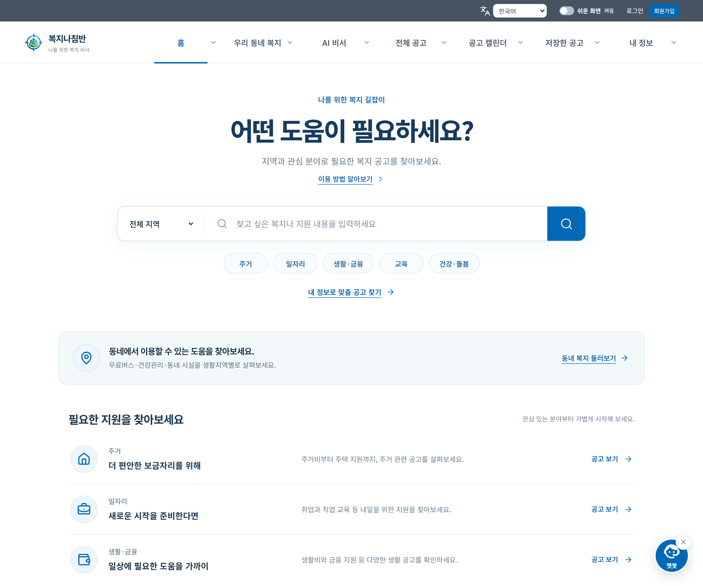

# Haetae · Developer Portfolio

**필요한 정보를 찾는 서비스와, 일상의 반복을 줄이는 도구를 만듭니다.**

[GitHub](https://github.com/haetae8554) · [대표 프로젝트](#복지나침반--bokji-compass) · [다른 프로젝트](#다른-프로젝트)

공공 정보를 정리하는 백엔드부터 사용자가 정보를 탐색하는 화면까지 연결합니다. 각 프로젝트에서 해결한 문제, 개인 담당 범위와 구현한 기능을 소개합니다.

## 복지나침반 · Bokji Compass

**복지 공고 탐색에서 조건 확인과 신청 준비까지 이어지는 복지 정보 서비스**

공공 API와 기관 공고를 한곳에서 찾고, 내 상황에 필요한 정보를 대화로 살펴볼 수 있는 팀 프로젝트입니다. 공고 원문과 신청 경로를 연결하고, 쉬운 화면과 다국어 UI로 접근성을 고려했습니다.

`Python` `FastAPI` `SQLAlchemy` `MySQL` `React` `JavaScript` `TypeScript` `React Native`

| 사용자 경험            | 구현한 기능                                                |
| :--------------------- | :--------------------------------------------------------- |
| 필요한 공고 찾기       | 검색·분야·지역·대상 필터, 공고 상세와 공식 출처            |
| 상황을 대화로 설명하기 | AI 복지 대화, 관련 공고 탐색과 추가 질문                   |
| 신청 준비 이어가기     | 관심 공고 저장, 신청 캘린더, 신청 방법·서류 안내           |
| 편한 방식으로 살펴보기 | 일반·쉬운 화면, 다국어 UI, 지역 생활서비스, 소득 기준 계산 |

**개인 담당:** 기획·팀 운영, 백엔드 개발과 DB 스키마 일부 작업, CLI 분석 연동, 프런트엔드 UI 구현 협업. 위 기능은 팀 결과물이며 개인 역할과 구분합니다.

[프로젝트 상세와 화면 보기 →](projects/bokji-compass.md) · [소스 코드](https://github.com/haetae8554/bokji-compass)

## 다른 프로젝트

### 모아 · Moa

**보유 종목 조회와 소수점 분할 주문을 연결하는 개인 투자 도구**

총금액 또는 총수량으로 분할 계획을 만들고, 로컬 웹 UI와 Chrome 사이드 패널에서 확인하는 개인 프로젝트입니다. 독립 Python 주문 모듈, Windows 자격 증명 저장, 결과 불명 주문의 자동 재전송 차단을 구현했습니다.

`Python` `JavaScript` `SQLite` `Chrome Manifest V3` `Windows Native Messaging`

- **사용 흐름:** 보유 종목 조회 → 분할 계획 확인 → 주문 실행·기록 확인
- **구현 초점:** UI와 주문 모듈 분리, 인증 정보 보관, 주문 상태와 중복 전송 처리
- **제공 형태:** PC에서 실행하는 개인 도구 · Chrome 웹 스토어 미등록

[프로젝트 상세 →](projects/moa-invest.md) · [소스 코드](https://github.com/haetae8554/moa-invest)

### AI Closet Stylist

**옷장과 날씨 정보를 바탕으로 코디를 제안하는 웹 애플리케이션**

2025년 OSS 수업 팀 프로젝트입니다. 등록한 옷과 날씨 정보를 Gemini에 전달하는 추천 흐름에서 **AI API 연동, 프롬프트 구성, JSON 응답 파싱**을 담당했습니다. 프런트엔드와 백엔드 전체는 팀 결과물로 구분합니다.

`React` `JavaScript` `Node.js` `Express` `Gemini API`

[프로젝트 상세 →](projects/ai-closet-stylist.md) · [소스 코드](https://github.com/haetae8554/AI-Closet-Stylist)

<strong>교육·기초 실습과 기록 기준</strong>

### 2025년 수업 과제와 기초 실습

| 활동                   | 다룬 내용                                       | 코드 공개 상태 |
| :--------------------- | :---------------------------------------------- | :------------- |
| C++ 자료구조 Project 2 | B+ Tree, Heap, Selection Tree 기반 데이터 관리  | 비공개         |
| C++ 자료구조 Project 3 | 그래프 표현, BFS·DFS, 최소 신장 트리, 최단 경로 | 비공개         |
| Git·Pull Request 실습  | 저장소 사용, fork·PR 흐름, 기초 JavaScript 함수 | 비공개         |

수업에서 제공한 코드와 개인의 추가 구현을 구분하며, 비공개 과제 코드나 제출 파일은 이 저장소에 복사하지 않습니다.

[과제·실습 기록](projects/coursework-2025.md)

### 기록 기준

- 팀 결과물과 개인 담당 영역을 구분합니다.
- 실제 제품 화면과 예시·가상 데이터 화면을 구분합니다.
- 구현한 기능과 검토 중인 계획을 구분합니다.
- 성능·테스트·실행 결과는 확인한 버전과 범위를 함께 기록합니다.
- 원본 기여 이력과 외부 자산의 저작권·라이선스 표기를 유지합니다.

이 포트폴리오의 관리자는 [haetae8554](https://github.com/haetae8554)입니다. 각 프로젝트와 외부 자산의 권리 및 공동 기여는 해당 원본 기록을 따릅니다.

[보존 기록](docs/archive/README.md) · [기록 추가 안내](CONTRIBUTING.md) · [프로젝트 템플릿](templates/project.md)

