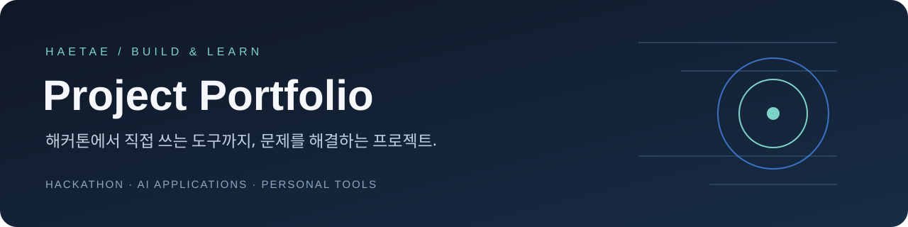

> 보존 기록 · 2026-10-30 포트폴리오 개편 전 README입니다. 당시 진행 상태와 후속 계획을 원문대로 보존하며, 현재 소개는 [포트폴리오 메인](../../README.md)을 참고하세요. 상대 링크만 이 문서의 위치에 맞게 조정했습니다.

# 개발 활동 기록

**해마다 무엇을 만들고 배웠는지, 내가 맡은 일과 함께 기록합니다.**

[GitHub](https://github.com/haetae8554) · [2026년](#year-2026) · [2025년](#year-2025) · [기록 추가하기](../../CONTRIBUTING.md)

해커톤, 개인 프로젝트, 수업 팀 프로젝트, 개별 과제와 실습을 연도별로 정리하는 저장소입니다. 프로젝트별로 참여 배경, 본인 역할, 구현 내용과 남은 과제를 기록합니다. 복지나침반은 가장 중점적으로 정리하는 프로젝트입니다.

| 연도 | 해커톤 | 개인 프로젝트 | 수업 팀 프로젝트 | 수업 과제·실습 |
| :--- | :--- | :--- | :--- | :--- |
| [2026](#year-2026) | 복지나침반 | 모아 · 토이 프로젝트 | — | — |
| [2025](#year-2025) | — | — | AI Closet Stylist · OSS 수업 | 자료구조 과제 2건, Git·PR 실습 |

## 2026년

### 해커톤 · 복지나침반

**2026 광운대학교 KW 해커톤 · 팀장 참여 · 본선 진출**

공공 복지 공고를 수집·정리하고, 사용자 조건에 따른 탐색부터 신청 준비와 지속 안내까지 연결하는 팀 프로젝트입니다. 현재 본선 점수 집계 중이며 수상 결과는 발표 전입니다.

`Python` `FastAPI` `SQLAlchemy` `MySQL` `React` `TypeScript` `React Native` `Codex CLI`

- **본인 역할:** 기획·팀 운영, 백엔드 개발과 일부 DB 스키마 작업, Codex CLI 연동
- **프론트엔드 작업:** 디자인 레퍼런스를 찾고 Codex에 작업을 지시하는 방식으로 참여
- **현재 기술 과제:** 자연어 요청 해석이 충분하지 않아 `jev` 활용을 고민 중. 시험 이후 검토할 계획이며 아직 구현 성과로 제시하지 않음

[프로젝트 상세 →](../../projects/bokji-compass.md) · [팀 소스 코드](https://github.com/2026-KW-HACKATHON/15_bokji-compass) · [README에 안내된 웹 서비스](https://bokji.commitnaru.com/)

### 개인 프로젝트

#### 토이 프로젝트 · 모아

**보유 종목 조회와 소수점 분할 주문을 토스 화면 옆에서.**

총금액 또는 총수량으로 주문을 계획하고 약 $9 단위로 나누어 전송하는 도구입니다. 재사용 가능한 Python 주문 모듈, 로컬 웹 UI, Chrome 사이드 패널로 구성했습니다.

`Python` `JavaScript` `SQLite` `Chrome Manifest V3` `Windows Native Messaging`

- **사용 흐름:** 내 투자 조회 → 분할 계획 확인 → 주문 실행·기록 확인
- **설계 포인트:** UI와 주문 모듈 분리, Windows 자격 증명 저장, 결과 불명 주문의 자동 재전송 차단
- **분류:** 개인 프로젝트 → 토이 프로젝트
- **현재 단계:** 개발 중 · 확장 웹 스토어 미등록

[프로젝트 상세 →](../../projects/moa-invest.md) · [소스 코드](https://github.com/haetae8554/moa-invest) · [자동 검사](https://github.com/haetae8554/moa-invest/actions/workflows/ci.yml)

## 2025년

### 수업 팀 프로젝트 · AI Closet Stylist

**OSS(오픈소스소프트웨어) 수업 팀 프로젝트 · AI 연동 담당**

등록한 옷과 날씨 정보를 바탕으로 AI 코디를 제안하는 웹 애플리케이션입니다.

React 화면과 Express API를 연결하고, 옷장·날씨 정보를 Gemini에 전달하는 추천 흐름을 구현했습니다. 프로젝트 README에 기재된 담당 영역은 AI API 연동, 프롬프트 구성, JSON 응답 파싱입니다.

`React` `JavaScript` `Node.js` `Express` `Gemini API`

- **사용 흐름:** 옷 등록 → 날씨·옷장 정보 반영 → 코디 추천 결과 확인
- **담당 영역:** AI 연동. 프론트엔드·백엔드는 팀원 역할과 구분해서 소개합니다.
- **분류:** OSS 수업 팀 프로젝트 · 공개 소스 기준 소개 · 실행 데모 검증 전

[프로젝트 상세 →](../../projects/ai-closet-stylist.md) · [소스 코드](https://github.com/haetae8554/AI-Closet-Stylist)

### 수업 과제 · C++ 자료구조

| 활동 | 과제에서 다룬 내용 | 코드 공개 상태 |
| :--- | :--- | :--- |
| 자료구조 Project 2 | B+ Tree, Heap, Selection Tree 기반 데이터 관리 | 비공개 |
| 자료구조 Project 3 | 그래프 표현, BFS·DFS, 최소 신장 트리와 최단 경로 알고리즘 | 비공개 |

수업에서 제공한 코드를 바탕으로 진행한 과제입니다. 활동과 학습 내용을 기록하며, 개인이 새로 구현한 부분의 상세 정리는 추후 보완합니다.

### 기초 실습 · Git·Pull Request

`oss_test`와 `oss2025-pr-test`에서 Git 저장소 사용, fork·PR 흐름과 기초 JavaScript 함수 구현을 연습했습니다. 두 저장소의 코드는 비공개로 보관합니다.

[2025년 과제·실습 기록 →](../../projects/coursework-2025.md)

## 기록 원칙

- 구현된 기능과 향후 계획을 구분합니다.
- 팀 프로젝트에서는 개인 담당 영역을 명시합니다.
- 연도와 활동 유형을 함께 적고, 수업 팀 프로젝트·개별 과제·기초 실습을 구분합니다.
- 개인 프로젝트는 목적에 따라 토이 프로젝트와 서비스 프로젝트로 세분화할 수 있습니다. 현재 모아는 토이 프로젝트로 기록합니다.
- 비공개 과제는 활동 요약만 기록하며 과제 코드·제출 파일을 이 저장소에 복사하지 않습니다.
- 성능 수치·테스트 결과는 확인한 버전과 근거를 함께 기록합니다.
- 데모 화면에는 가상 데이터를 사용합니다.

새 활동은 [공통 템플릿](../../templates/project.md)으로 추가합니다. [분류 기준과 보완할 내용](../curation.md)도 함께 관리합니다.
