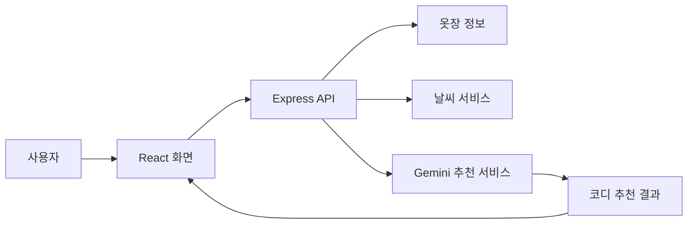

# AI Closet Stylist

> 옷장과 날씨 정보를 바탕으로 코디를 제안하는 AI 웹 애플리케이션.

**2025년 · OSS(오픈소스소프트웨어) 수업 팀 프로젝트**

[전체 프로젝트로 돌아가기](../README.md) · [소스](https://github.com/haetae8554/AI-Closet-Stylist)

| 항목 | 내용 |
| :--- | :--- |
| 연도 | 2025년 |
| 구분 | OSS(오픈소스소프트웨어) 수업 팀 프로젝트 |
| 기술 | React, JavaScript, Node.js, Express, Gemini API |
| 본인 담당 | 프로젝트 README 기준: AI API 연동, 프롬프트 구성, JSON 응답 파싱 |
| 공동 담당 | README 기준: 데이터 관리, 테스트·문서화 |
| 소개 범위 | 공개 README와 소스 구성 확인. 이번 정리에서 앱 실행·배포 상태는 검증하지 않음 |

## 해결하려던 문제

사용자가 이미 가진 옷과 그날의 날씨를 함께 고려해 코디를 고를 수 있도록, 옷 등록부터 AI 추천 결과까지 하나의 흐름으로 연결하는 프로젝트입니다.

## 확인한 구성

- 프론트엔드에는 옷 등록, 옷장, 추천·결과, 캘린더 화면 파일이 있습니다.
- Express 서버에는 옷 조회·등록·수정·삭제, 추천, 날씨, 캘린더 API 경로가 있습니다.
- Gemini 서비스에는 날씨·계절·요일 문맥 구성과 추천 요청 함수가 있습니다.
- 날씨 서비스에는 위치 처리와 기상청 예보 조회 관련 함수가 있습니다.

## 본인 역할을 보여줄 부분

팀 README는 한태윤의 담당을 **AI 연동**으로 명시하고 있습니다. 프론트엔드와 백엔드 전체를 개인 단독 작업으로 소개하지 않습니다.

| 담당 영역 | 살펴볼 소스 | 설명할 내용 |
| :--- | :--- | :--- |
| 추천 요청 구성 | [geminiService.js](https://github.com/haetae8554/AI-Closet-Stylist/blob/main/backend/src/services/geminiService.js) | 옷장과 날씨 문맥을 추천 요청에 어떻게 넣었는지 |
| 응답 처리 | 같은 서비스 파일 및 연동 부분 | JSON 결과를 UI가 사용할 형식으로 다루는 방식 |
| 팀 연동 | [server.js](https://github.com/haetae8554/AI-Closet-Stylist/blob/main/backend/src/server.js) | 추천 API 입력·출력과 프론트엔드 연결 지점 |

담당 범위의 근거는 [팀 역할 표](https://github.com/haetae8554/AI-Closet-Stylist/blob/main/README.md)입니다. 세부 함수별 개인 기여와 문제 해결 사례는 관련 커밋을 확인해 보강할 예정입니다.

## 포트폴리오 보완 과제

1. 실제 앱을 실행해 옷 등록 → 추천 결과 흐름을 확인하고, 개인 정보 없는 화면을 기록합니다. 기존 README 이미지는 AI로 생성한 예상도이므로 실제 동작 화면으로 소개하지 않습니다.
2. 원본 README의 초기 계획을 현재 코드와 맞춥니다. README에는 Gemini 1.5 Flash·OpenWeatherMap이 적혀 있으나, 확인한 소스에는 Gemini 2.5 계열 모델명과 기상청 조회 코드가 있습니다.
3. 본인이 맡은 JSON 처리나 프롬프트 개선 사례를 전후 입력·출력 및 커밋으로 설명합니다. 아직 확인하지 않은 정확도·성능 수치는 추가하지 않습니다.
4. 저장소에 포함된 `node_modules`를 의존성 설치 방식으로 정리하는 작업을 검토합니다.

이 페이지는 현재 공개 소스에 근거한 소개입니다. 위 보완 작업은 원본 프로젝트에 아직 적용하지 않았습니다.
