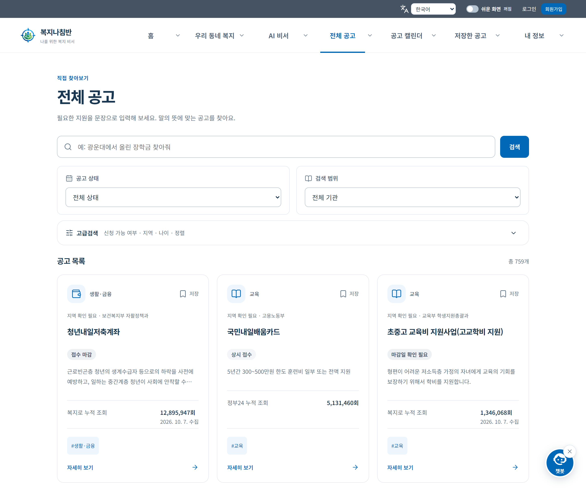
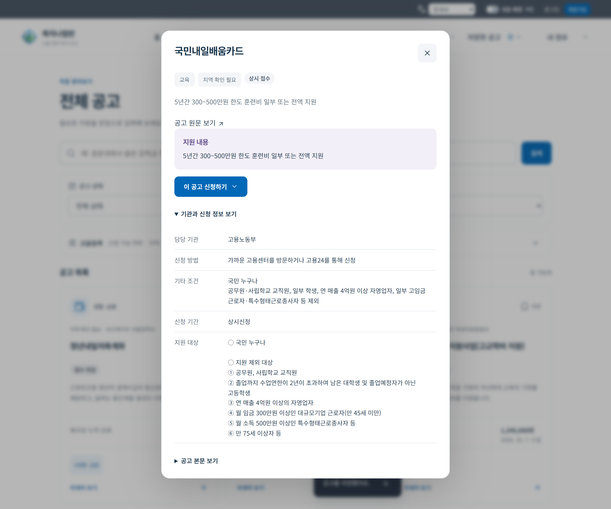
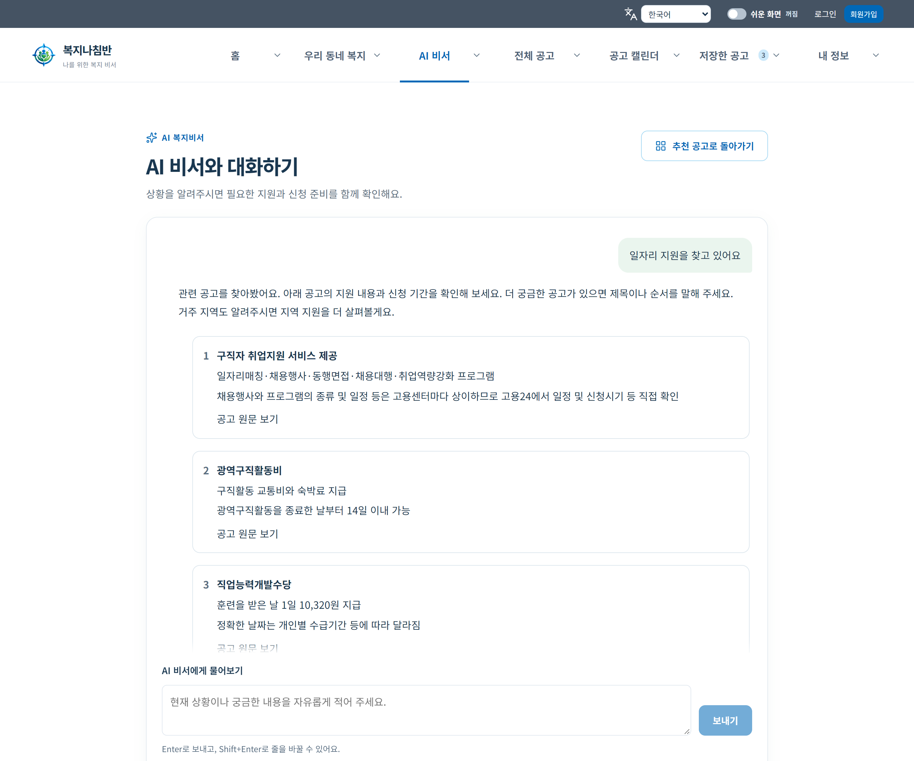
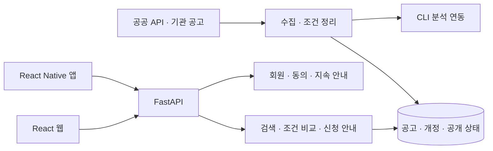

# 복지나침반 · Bokji Compass

> 필요한 복지 공고를 찾는 단계부터 조건 확인과 신청 준비까지 연결하는 복지 정보 서비스.

[포트폴리오로 돌아가기](../README.md) · [소스 코드](https://github.com/haetae8554/bokji-compass)

| 항목      | 내용                                                                                          |
| :-------- | :-------------------------------------------------------------------------------------------- |
| 구분      | 2026년 · 팀 프로젝트                                                                          |
| 개인 담당 | 기획·팀 운영, 백엔드 개발, DB 스키마 일부 작업, CLI 분석 연동, 프런트엔드 UI 구현 협업        |
| 주요 기술 | Python · FastAPI · SQLAlchemy · MySQL · React · JavaScript · TypeScript · React Native · Expo |
| 주요 흐름 | 공고 탐색 → 상황·조건 확인 → 신청 준비 → 저장·일정 확인                                       |

## 해결하려는 문제

복지 공고를 발견해도 거주지와 연령, 생활 상황에 맞는 지원인지 다시 확인해야 합니다. 기관마다 다른 공고 형식과 신청 경로도 탐색을 어렵게 만듭니다.

복지나침반은 공식 공고를 모아 검색하고, 지원 조건과 원문 근거를 함께 살펴보도록 구성했습니다. 대화로 상황을 설명하거나 관심 공고를 저장하고 신청 일정을 확인할 수 있습니다. 일반·쉬운 화면과 다국어 UI로 서로 다른 이용 환경을 고려했습니다.

## 제품 화면

아래는 **2026-10-30 실제 공고 데이터를 연결한 로컬 웹 화면**입니다. 개인 회원 정보와 실제 금융 입력은 포함하지 않았습니다.

### 1. 필요한 지원을 찾는 메인

지역과 관심 분야로 공고를 찾고, 주요 기능으로 이동하는 시작 화면입니다.

### 2. 검색과 필터로 좁히는 공고 탐색

검색어와 분야·지역·대상 조건으로 실제 공고 목록을 살펴봅니다. 공고별 지원 내용과 신청 기간을 확인하고 상세 화면으로 이어집니다.

### 3. 원문 근거와 신청 준비를 연결하는 상세

지원 대상과 내용을 정리하고, 공식 원문·신청 방법·첨부 파일로 연결합니다. 추천과 안내는 탐색을 돕는 참고 정보이며, 지원 자격을 확정하거나 신청을 대신 제출하지 않습니다.

### 4. 생활 상황을 말로 풀어가는 복지 대화

필요한 지원이나 신청 준비에 관해 질문하고, 관련 정보를 대화로 살펴봅니다. 비회원 대화와 계정에 저장하는 생활정보·지속 안내를 구분합니다.

## 개인 역할과 협업 범위

| 담당 영역       | 참여 내용                                                   |
| :-------------- | :---------------------------------------------------------- |
| 기획·팀 운영    | 프로젝트 방향과 사용자 흐름을 정리하고 팀 운영에 참여       |
| 백엔드·데이터   | 백엔드 개발, DB 스키마 일부 작업, 공고 분석을 위한 CLI 연동 |
| 프런트엔드 협업 | 디자인 레퍼런스 검토와 사용자 UI 구현 협업                  |

역할은 본인의 설명을 기준으로 정리했습니다. 제품 화면과 아래 기능은 공동 결과물이며, 팀 전체 구현을 개인 단독 작업으로 표현하지 않습니다.

## 기능과 기술 구성

| 영역        | 구현 구성                                                       |
| :---------- | :-------------------------------------------------------------- |
| 공고 데이터 | 공공 API·기관 공고 수집, 원문·조건·개정·공개 상태 관리          |
| 탐색과 추천 | 검색·분야·지역·대상 필터, 조건 비교와 추천 이유, 대화형 탐색    |
| 신청 준비   | 공식 신청 경로, 첨부 파일·서류 안내, 저장 공고와 신청 캘린더    |
| 개인 안내   | 회원 인증, 동의 기반 생활정보 저장, 지속 안내와 앱 내 알림      |
| 접근성      | 일반·쉬운 화면, 다국어 UI·공고 번역, 반응형 메뉴                |
| 생활·금융   | 공식 자료 기반 지역 생활서비스, 중위소득 기준과 소득·재산 계산  |
| 웹·모바일   | React·Vite 웹, React Native·Expo 앱, 공통 금융 모델과 번역 자원 |

공개 카탈로그는 공고의 공개 상태와 개정 변경을 확인하고, 중복 계산과 캐시 보관량을 제한합니다. 회원 조건에 따른 결과는 공유 카탈로그 캐시와 구분합니다.

<strong>소스 기준·공동 기여와 자료 출처</strong>

### 소스와 화면의 기준

- 현재 개인 저장소의 확인 버전은 [b008fdc](https://github.com/haetae8554/bokji-compass/tree/b008fdc2c81bce4caf68b3b27cf1005fd6f54f4e)입니다. 원본 팀 이력과 최신 로컬 개선을 함께 보존했습니다.
- 화면은 2026-10-30 실제 공고 데이터와 해당 작업본의 웹 UI를 로컬로 실행한 캡처입니다. 회원 개인정보는 포함하지 않았습니다.
- 자동 검증: 백엔드 3,371개 통과·82개 조건부 제외, 웹 227개 통과·production 빌드 통과, 모바일 150개 통과·타입 검사·린트 통과. [검증 범위](https://github.com/haetae8554/bokji-compass/blob/b008fdc2c81bce4caf68b3b27cf1005fd6f54f4e/docs/verification-2026-10-30.md)를 함께 확인할 수 있습니다.
- 웹과 Android 앱의 기능 범위·배포 상태는 각각 다를 수 있습니다. 공개 도메인의 가용성을 현재 운영 실적으로 제시하지 않습니다.

### 공동 기여 기록

원본 팀 저장소와 Git 이력은 공동 작업의 근거로 보존합니다. 개별 커밋에는 여러 사람이 함께 작업한 내용이 포함될 수 있으며, 계정의 저장소 관리 권한과 전체 결과물의 개인 독점 저작권은 구분합니다.

- [원본 팀 저장소](https://github.com/2026-KW-HACKATHON/15_bokji-compass)
- [대화형 검색·공고·반응형 UI 변경](https://github.com/2026-KW-HACKATHON/15_bokji-compass/commit/a10c01ecf0854a9dea6fb19dd014e9aa724705ea)
- [공고 캐시와 부하 검사 도구](https://github.com/2026-KW-HACKATHON/15_bokji-compass/commit/c4bbed215a4bed61d59bff05860f4560f5273e8f)
- [팀 변경사항 통합](https://github.com/2026-KW-HACKATHON/15_bokji-compass/commit/0be1b132b955b0bd3ba4cb825ce75acd6ca05da9)

위 링크는 변경 내용의 근거이며 모든 변경을 개인 단독 기여로 귀속하는 목록이 아닙니다.

### 외부 자산과 보존 문서

Expo의 MIT 고지와 Pictogrammers 아이콘의 출처·라이선스는 원본 소스에서 유지합니다. 이 포트폴리오에 새로운 개인 독점 라이선스를 부여하지 않습니다.

- [Expo 고지](https://github.com/2026-KW-HACKATHON/15_bokji-compass/blob/6a5fa9c7ba1b4484edd19c394c4606ef75574202/frontend/mobile/LICENSE)
- [아이콘 출처](https://github.com/2026-KW-HACKATHON/15_bokji-compass/blob/6a5fa9c7ba1b4484edd19c394c4606ef75574202/frontend/web/public/icons/README.md)
- [개편 전 프로젝트 기록](../docs/archive/bokji-compass-before-2026-10-30.md)
- [보존 기록 안내](../docs/archive/README.md)

기존 안내에 사용된 [공개 도메인](https://bokji.commitnaru.com/)은 참고 링크로 남깁니다. 현재 접속 가능 여부를 보장하는 운영 링크가 아닙니다.

