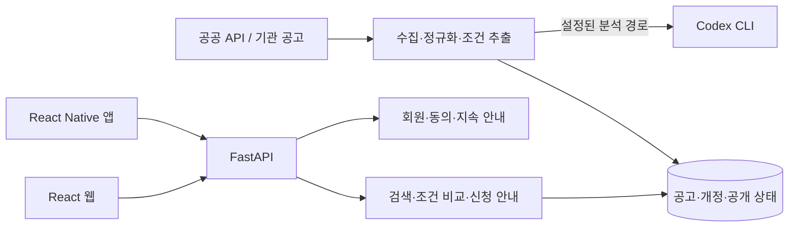

# 복지나침반 · Bokji Compass

> 필요한 복지 공고를 찾는 단계부터 조건 확인과 신청 준비까지 연결하는 팀 프로젝트.

**2026 광운대학교 KW 해커톤 · 팀장 참여 · 본선 진출**

[전체 프로젝트로 돌아가기](../README.md) · [팀 저장소](https://github.com/2026-KW-HACKATHON/15_bokji-compass) · [README에 안내된 웹 서비스](https://bokji.commitnaru.com/)

| 항목 | 내용 |
| :--- | :--- |
| 프로젝트 | 복지나침반 / 2026 KW 해커톤 15조 |
| 본인 역할 | 팀장, 기획·팀 운영, 백엔드, 일부 DB 스키마 작업, Codex CLI 연동, 디자인 레퍼런스 선정과 Codex 작업 지시 |
| 대회 현황 | 본선 진출, 점수 집계 중. 수상 결과 발표 전 — 2026-10-16 본인 설명 기준 |
| 주요 기술 | Python, FastAPI, SQLAlchemy, MySQL, React, JavaScript, TypeScript, React Native, Expo, Codex CLI |
| 확인한 소스 버전 | [6a5fa9c](https://github.com/2026-KW-HACKATHON/15_bokji-compass/tree/6a5fa9c7ba1b4484edd19c394c4606ef75574202) |

## 문제와 서비스 방향

복지 공고를 발견해도 나이·지역·생활 상황에 맞는지, 어떤 서류가 필요한지 다시 확인해야 합니다. 공고 탐색부터 신청 준비까지 이어지는 과정을 돕는 것이 프로젝트의 방향입니다.

팀 README는 어르신, 주소지와 생활지역이 다른 청년, 자격 조건이 낯선 유학생의 이용 상황을 설명합니다. 일반·쉬운 화면과 다국어 UI, 공고 원문과 근거 연결을 통해 접근성을 고려했습니다. 추천·계산 결과는 참고 정보이며 공식 자격 판정이나 신청 대행은 수행하지 않습니다.

[서비스 문제 정의와 기능 설명](https://github.com/2026-KW-HACKATHON/15_bokji-compass/blob/6a5fa9c7ba1b4484edd19c394c4606ef75574202/readme.md)

## 내가 맡은 역할

아래 역할은 본인 설명을 기준으로 작성했습니다. 공개 커밋은 참여 이력을 살펴볼 추가 근거이며, 커밋 하나에 여러 사람이 함께 작업한 내용이 포함될 수 있습니다.

| 역할 | 참여 내용 |
| :--- | :--- |
| 기획·팀 운영 | 팀장으로 프로젝트 기획과 팀 운영에 참여 |
| 백엔드 | 백엔드 개발, DB 스키마 일부 작업, Codex CLI 연동 |
| 프론트엔드 | 디자인 레퍼런스를 찾고 Codex에 작업을 지시하는 방식으로 참여 |
| 기술 개선 검토 | 자연어 요청 처리의 현재 한계를 인식하고 `jev` 활용 방식을 고민 중 |

AI 도구를 사용한 개발 과정을 포함해 소개합니다. 포트폴리오의 설명은 본인이 결정한 문제·설계·검증 내용을 중심으로 보완하며, 팀의 전체 구현을 개인 단독 작업으로 표현하지 않습니다.

## 팀 프로젝트의 구현 구성

참고 버전의 README와 소스에서 확인한 구성입니다. 아래 전체 기능 목록은 팀 결과물이며 개인별 담당 목록과 구분합니다.

| 영역 | 확인한 구성 |
| :--- | :--- |
| 공고 데이터 | 공공 API·기관 공고 수집, 원문·조건·개정·공개 상태 관리 |
| 탐색과 안내 | 공고 필터·조건 비교, 대화형 탐색 경로, 신청 안내·첨부 파일·일정 |
| 사용자 기능 | 회원 인증, 동의에 따른 정보 저장, 지속 안내·알림·서류 준비 기록 |
| 웹 | React·Vite, 일반·쉬운 화면, 다국어 UI |
| 모바일 | TypeScript·React Native·Expo, 웹과 금융 모델·번역 자원 일부 공유 |
| 운영·검증 | Windows 운영 스크립트, Caddy·Cloudflare Tunnel, pytest·Node·Playwright 등 |

구성 근거: [프로젝트 README](https://github.com/2026-KW-HACKATHON/15_bokji-compass/blob/6a5fa9c7ba1b4484edd19c394c4606ef75574202/readme.md), [웹 패키지 설정](https://github.com/2026-KW-HACKATHON/15_bokji-compass/blob/6a5fa9c7ba1b4484edd19c394c4606ef75574202/frontend/web/package.json).

## 개발 참여를 확인할 수 있는 기록

`haetae8554` 계정의 공개 커밋에서 확인한 사례입니다. 개별 변경의 설계 의도와 본인의 구체적 판단은 추가 회고로 보강할 내용입니다.

| 기록 | 확인한 변경 |
| :--- | :--- |
| [대화형 검색·공고·반응형 UI 개선](https://github.com/2026-KW-HACKATHON/15_bokji-compass/commit/a10c01ecf0854a9dea6fb19dd014e9aa724705ea) | 대화형 검색 경로, 관련 공고 묶음·첨부 파일, 모바일 메뉴와 회귀 테스트 등 |
| [공고 캐시와 부하 검사 도구](https://github.com/2026-KW-HACKATHON/15_bokji-compass/commit/c4bbed215a4bed61d59bff05860f4560f5273e8f) | 공개 카탈로그 캐시, 캐시 테스트, 부하 검사 도구 |
| [팀 변경사항 통합](https://github.com/2026-KW-HACKATHON/15_bokji-compass/commit/0be1b132b955b0bd3ba4cb825ce75acd6ca05da9) | 카탈로그 개선과 팀의 번역 변경사항 통합 |

예를 들어 공개 카탈로그 캐시에는 공개 개정 상태 재확인, 같은 요청의 중복 계산 공유, 보관 용량 제한, 회원 조건 결과를 공유 캐시에서 제외하는 로직이 있습니다. 테스트는 공고 비공개 전환, 개정 변경, DB 확인 실패, 회원 간 결과 분리와 동시 요청을 다룹니다.

[캐시 구현](https://github.com/2026-KW-HACKATHON/15_bokji-compass/blob/6a5fa9c7ba1b4484edd19c394c4606ef75574202/backend/app/modules/storage/catalog_cache.py) · [회귀 테스트](https://github.com/2026-KW-HACKATHON/15_bokji-compass/blob/6a5fa9c7ba1b4484edd19c394c4606ef75574202/backend/tests/test_catalog_cache.py)

## 가장 중요한 다음 과제: 자연어 요청 처리

현재 본인이 가장 크게 느끼는 한계는 **자연어 요청을 충분히 처리하지 못한다는 점**입니다. 저장소에 검색 해석·대화형 탐색 코드가 있다는 사실과, 실제 사용자의 자연어 의도를 잘 처리한다는 평가는 다릅니다. 현재 이를 해결한 것으로 소개하지 않습니다.

`jev`를 활용하는 방식을 고민 중이며 시험 이후 검토할 계획입니다. 여기서 `jev`는 본인이 언급한 명칭을 그대로 기록한 것으로, 구체적인 도구·연결 방식과 채택 여부는 아직 확정하지 않았습니다.

개선 작업에서 확인할 질문은 다음과 같습니다.

1. 어떤 입력에서 실패하는가? 실제 개인 정보가 없는 예문을 모아 현재 결과와 기대 결과를 비교합니다.
2. 무엇을 추출해야 하는가? 지역·연령·지원 목적·생활 상황을 구분하고 정보가 부족하면 되묻는 기준을 정합니다.
3. 어디까지 도구에 맡길 것인가? 자연어 해석과 공고 조회·조건 비교를 분리하고 결과를 검증할 경계를 정합니다.
4. 어떻게 개선을 판단할 것인가? 같은 평가 예문으로 기존 방식과 후보 방식을 비교하고 해석 오류·추가 질문·공고 연결 결과를 기록합니다.

위 항목은 후속 검토안이며 구현 완료나 성능 개선 결과가 아닙니다. 자연어 처리의 전후 비교는 실제 작업·검증 이후 추가합니다.

## 검증 자료와 현재 한계

팀 저장소에는 [2026-10-08 QA 기록](https://github.com/2026-KW-HACKATHON/15_bokji-compass/blob/6a5fa9c7ba1b4484edd19c394c4606ef75574202/frontend/docs/qa-2026-10-08.md)과 기능별 테스트가 있습니다. 이 포트폴리오 정리에서는 서비스를 실행하거나 테스트를 다시 수행하지 않았습니다. 기존 QA는 최초 검사와 실패 수정 후 재검사를 구분하며, 최신 전체 기능의 재검증 결과로 옮겨 적지 않습니다.

현재 보완할 내용은 다음과 같습니다.

- 해커톤 제출·발표 시점의 버전을 특정해 이후 개선과 구분하기
- 개인 정보 없는 실제 화면과 짧은 사용 시연 추가하기
- 기획·팀 운영에서 내린 구체적인 결정과 어려웠던 협업 사례 정리하기
- 자연어 처리 실패 예문과 시험 이후 개선 과정 기록하기
- 공식 수상 결과 발표 후 대회 현황 갱신하기

[팀 발표 자료](https://github.com/2026-KW-HACKATHON/15_bokji-compass/tree/6a5fa9c7ba1b4484edd19c394c4606ef75574202/중간발표_자료)
