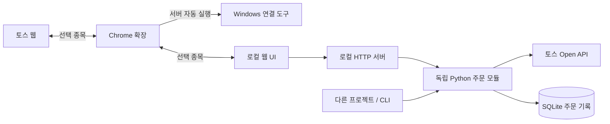

# 모아 · Moa

> 내 PC에서 실행하는 투자 데스크와 재사용 가능한 소수점 분할 주문 모듈.

[전체 프로젝트로 돌아가기](../README.md) · [소스](https://github.com/haetae8554/moa-invest) · [사용 안내](https://github.com/haetae8554/moa-invest/blob/main/docs/usage.md)

| 항목 | 내용 |
| :--- | :--- |
| 구분 | 개인 프로젝트 · 개발 중 |
| 기술 | Python 3.11+, JavaScript, SQLite, Chrome Manifest V3 |
| 실행 환경 | 로컬 Python 서버 + 웹 UI + Chrome 확장. 키 저장·자동 실행은 Windows 연동 |
| 참고 버전 | Python 패키지 0.7.0 / 확장 0.5.1 · [c4a2d6e](https://github.com/haetae8554/moa-invest/commit/c4a2d6e) |

## 해결하려던 문제

총금액 또는 총수량을 정한 뒤 작은 주문 여러 건으로 나눠 실행하려면 반복 입력과 진행 상태 확인이 필요합니다. 토스 화면과 별도 주문 도구에서 같은 종목을 계속 선택하는 번거로움도 있었습니다.

모아에서는 한 번 입력한 계획을 기준으로 분할 주문을 만들고, 토스 탭과 모아 패널의 선택 종목을 연결합니다. $9는 분할 기준이며 수수료 면제나 특정 체결 결과를 보장하는 값으로 소개하지 않습니다.

## 구현한 흐름

1. API 키를 입력하고 계좌 연결을 확인합니다.
2. 보유 종목을 조회하거나 주문할 종목을 선택합니다.
3. 매수·매도, 총금액·총수량으로 계획을 만듭니다.
4. 미리보기를 확인한 뒤 분할 주문을 시작합니다.
5. 접수 기록을 확인하고, 아직 전송하지 않은 주문을 중단할 수 있습니다.

## 구조와 선택 이유

- **모듈 재사용:** 주문 모듈이 UI를 import하지 않도록 분리했습니다. 화면을 바꾸더라도 주문 로직을 재사용할 수 있습니다.
- **키 보관:** 웹에서 입력한 인증 정보는 모아 전용 Windows 자격 증명 항목에 저장합니다. 확장과 종목 연결 메시지에는 계좌 정보·키를 전달하지 않습니다.
- **금액 계산:** Python `Decimal`을 사용해 금액과 소수점 수량을 계산합니다.
- **중복 전송 방지:** 주문 결과를 알 수 없을 때 자동 재전송하지 않고 추가 전송을 차단합니다. 주문 접수와 체결도 구분합니다.

## 실제 오류를 고친 사례

Chrome 사이드 패널이 로컬 화면을 불러오기 전에 `postMessage`를 보내면, 아직 확장 출처에 속한 빈 iframe과 대상 출처가 달라 오류가 발생했습니다.

수신 창과 출처를 확인한 준비 완료 메시지를 받은 뒤에만 통신하도록 바꾸고, 다시 연결할 때 iframe을 교체해 이전 화면의 지연 응답을 무시하도록 수정했습니다. 초기 로딩, 연결 실패, 연속 재연결, 오래된 응답을 다루는 회귀 테스트를 추가했습니다.

[수정 코드와 테스트](https://github.com/haetae8554/moa-invest/commit/c4a2d6e)

## 검증과 현재 범위

참고 커밋에서 로컬 Python 테스트 100개와 JavaScript 테스트 35개가 통과했습니다. 테스트 숫자는 해당 버전 기준이며, 모든 실제 거래·브라우저 환경에서의 동작을 의미하지 않습니다. 테스트 과정에서 실제 주문은 전송하지 않았습니다.

오프라인 데모는 가상 종목 데이터로 분할 계산과 화면 흐름을 보여줍니다.

- Chrome 확장 웹 스토어 등록과 Windows 배포 패키지 서명은 완료되지 않았습니다.
- 현재 확장 단독으로 주문 엔진이 실행되는 구조는 아닙니다.
- 서버가 종료된 뒤 남은 주문을 자동 재개하지 않습니다.

## 다음 설계 과제

TypeScript 공통 주문 엔진과 확장 단독 실행을 검토 중입니다. 확정·구현된 기능은 아니며, API 인증 호환성, 키 보관, 백그라운드 종료 후 주문 상태 복구를 먼저 검증해야 합니다.

[보안 설계](https://github.com/haetae8554/moa-invest/blob/main/SECURITY.md) · [개인정보 처리](https://github.com/haetae8554/moa-invest/blob/main/PRIVACY.md) · [로드맵](https://github.com/haetae8554/moa-invest/blob/main/ROADMAP.md)
